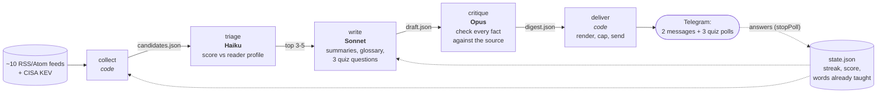

# 🛡 Cybersecurity News: a morning brief that gets read

[](https://github.com/metap00/Cybersecurity_News/actions/workflows/tests.yml)

**A self-hosted pipeline that turns ~10 security feeds into a plain-English Telegram brief every morning: 3-5 fact-checked stories, the day's new words, and 3 quiz questions that prove it was read.** Four small stages with three Claude models (Haiku, Sonnet, Opus) and plain Python, standard library only, 60+ tests.

```sh
python -m brief.run --demo     # see a real brief in your terminal: no tokens, no network, no setup
```

## The problem

I am moving into a junior SOC analyst role, so I built myself a daily security digest. Then I stopped reading it.

The first version was a single AI agent with one 16 KB prompt that fetched, ranked, wrote and emailed everything. When I measured it, the reasons I skipped it were plain:

- **Too long.** Median 605 words and 7 stories per email, plus a 2,900-word web page.
- **The useful part was hidden** behind clicks.
- **It never asked anything of me,** so nothing showed whether I had read it.
- **A third of the sends were empty** (36 of 116) because feeds failed, and they still went out.
- **About 6% of the links were wrong** (a feed URL or a homepage instead of the article).

So I redesigned it around one goal: **the brief gets read.** It is written for one reader (the profile in [`profile.md`](profile.md)), it fits on a phone, everything is readable without a click, and a 3-question quiz plus a streak make reading visible. The full diagnosis and design are in [`PLAN.md`](PLAN.md).

## How it works



| Stage | Who | What it does |
|---|---|---|
| **collect** | code | Fetches the feeds since the last send. Merges duplicates (same URL or same CVE) and drops anything sent in the last 14 days. Flags CVEs on CISA's Known Exploited Vulnerabilities (KEV) list. |
| **triage** | Claude Haiku | Scores each candidate 0-10 against the reader profile and labels it *act* / *learn* / *know* / *skip*. Code keeps the top 3-5. |
| **write** | Claude Sonnet | Drafts each story: a 3-5 sentence summary, the ATT&CK technique and how it applies, the threat actor (only if the source names one), and why it matters to the reader. Also drafts a glossary, a "Today I learned" concept and 3 quiz questions. |
| **critique** | Claude Opus | Checks every sentence against the feed text and every quiz answer. Gives each item *pass*, *fixed* or *drop*. Code then picks the stories within a word budget. |
| **deliver** | code | Renders Telegram HTML, enforces the caps, sends 2 messages and 3 quiz polls, and records state. The next run closes the polls and reads the answers. |

On Sundays a short recap replaces the brief: read rate, the week's pattern, one weekend read, and up to 3 missed questions asked again.

## A real brief

Rendered from [`examples/digest.json`](examples/digest.json), the output of a real run on 2026-11-21 (`python -m brief.run --demo` prints all of it). Two of the four stories:

```text
🟠 China-linked group Armory Castle exploits VMware vCenter zero-day
Dark Reading reports that a China-linked threat group, called Armory Castle, is attacking
VMware vCenter with a zero-day (a flaw the vendor did not know about yet). The group likely
held this flaw in reserve while the last big round of vCenter updates shipped. vCenter
manages virtual machines, so control of it gives wide reach. Defenders should watch for
vendor patches, limit who can reach vCenter, and review its logs.
🎯 T1190 Exploit Public-Facing Application: a zero-day in a reachable management platform
   like vCenter can give attackers entry before defenders can patch.
👤 Armory Castle: a China-nexus threat group, reported here going after VMware vCenter
   with a zero-day.
Why it matters to you: vCenter attacks fit the Cyber Kill Chain stages you're studying.
Source: Dark Reading

🟡 WhatsApp patches three flaws, one Android bug tied to scams
WhatsApp fixed three security flaws. One affects WhatsApp for Android and WhatsApp Business
for Android before version 2.26.17.4. It is incomplete validation of external ad-reply
URLs, meaning the app does not fully check a link before trusting it. The score is low
(CVSS 3.5), but WhatsApp suspects it was used in scam messages. Users should update the app.
🎯 T1566 Phishing: WhatsApp suspects this link-check flaw was abused in scam messages.
Why it matters to you: Phone scams show your phishing analysis skills apply beyond email.
Source: The Hacker News
```

The second message:

```text
💡 Today I learned: Overlay Attack
An overlay attack draws a fake screen on top of a real app. Banking Trojans use it to
capture passwords or to hide what the malware is doing underneath, often after gaining
accessibility permissions. Defenders spot it by alerting on unusual accessibility requests
and by blocking apps from outside official stores.

📖 Words of the day
• KEV: CISA's Known Exploited Vulnerabilities list: flaws with evidence that attackers are
  using them right now.
• CVSS: A 0–10 score for how severe a vulnerability is; 9.0 and above counts as critical.
• zero-day: A flaw attackers use before the vendor has released a patch.

▶ Do now (2 min): Read the ATT&CK page for T1190 Exploit Public-Facing Application.

Done. Last quiz 2/3 · Last 7 days ➖➖✅✅⬜✅✅ · streak 2 · 3 quick questions below ↓
```

Then the three native Telegram quiz polls. The third is an applied one:

```text
CISA adds a VMware vCenter flaw to KEV. Your asset list shows an internet-facing vCenter
server. What is your first move?
  A) Check vCenter version and exposure against advisory   ✔
  B) Ignore it until a scanner flags it
  C) Reboot the vCenter server right away
```

## Design decisions

**A separate critic stage.** The model that writes a summary is a poor judge of its own claims. So the writer drafts more stories than are needed, and a stronger model (Opus) checks each one sentence by sentence against the feed text. Every fact about an event must come from the source; background knowledge may only explain a concept. The critic fixes or drops anything unsupported, and code picks from what survives. In the logs it regularly catches claims like "a patch is available" when the source never said so. A wrong fact in a learning tool teaches the wrong thing, so that check is worth the most expensive model.

**Models never write URLs.** Every link is copied by code from the collector's record of the feed item. ATT&CK links are built by code, only from an ID that matches `^T\d{4}(\.\d{3})?$`. Model output containing `http`, `www.` or `<` is rejected. A model cannot invent a link, and a poisoned feed cannot inject one.

**Feed text is untrusted input.** It is wrapped in tags and marked as data in every prompt. The model stages run with no tools (`claude -p --tools ""`), return JSON constrained by a schema, and all of their text is HTML-escaped before it reaches Telegram. Hard caps on every field (headline 12 words, summary 40-80, options 8, 750 words in total…) are checked in code after the writer, after the critic and again at send.

**A quiz and a streak, not a longer digest.** The old version could not tell whether it was read. Now each brief ends with 3 Telegram quiz polls: one on the top story, one on a new word or concept, and one "you're the analyst on shift, what do you do first?" question. The next run closes the polls with `stopPoll` and records the answers. The footer shows yesterday's score and the streak, and on Sunday the missed questions come back. Glossary terms and "Today I learned" concepts are remembered so they are never taught twice.

**Small stages with file contracts.** Each stage reads one JSON file and writes the next (contracts in [`PLAN.md` section 8](PLAN.md#8-contracts)). So any stage can be run, tested or replayed alone from a fixture. State (`data/state.json`) is written by code only, never by a model.

**Self-hosted, on a subscription.** A systemd user timer on a small Linux VPS runs it at 06:30 local time. The model calls go through the Claude Code CLI on a Claude subscription, so there is no API key and no per-call bill. Secrets live in a mode-600 `.env` that is never committed. A failed run sends one Telegram line naming its log file. Setup: [`docs/deploy.md`](docs/deploy.md).

## Run it

Python 3.11+, standard library only.

```sh
python -m brief.run --demo                    # render the example brief: no tokens, no network
python -m pytest -q                           # the test suite: no network, no tokens
python -m brief.run --dry-run                 # the real pipeline: live feeds and models, sends nothing
python -m brief.run                           # real send (needs the .env below)
```

`--dry-run` and a real run need the [`claude`](https://docs.claude.com/en/docs/claude-code) CLI, logged in or with `CLAUDE_CODE_OAUTH_TOKEN` set. A real send also needs `TELEGRAM_BOT_TOKEN` and `TELEGRAM_CHAT_ID`. Each stage also runs alone (`python -m brief.collect`, `brief.triage`, …). To make it yours, edit [`profile.md`](profile.md) (what you use, what you study, what to skip) and [`feeds.opml`](feeds.opml).

## Tests

`tests/` covers every stage without network or tokens. Feeds are parsed from fixture XML, the model is replaced by canned JSON or a fake `claude` CLI, and Telegram by a fake `urlopen`. Among the cases:

- the caps, and a model URL being rejected;
- the critic's fixes and drops, and links always copied from the collector;
- syncing all 3 polls into a score and streak;
- old-format state migrating;
- a message split under Telegram's 4096 characters;
- the bot token never appearing in an error.

CI runs them on Python 3.11 and 3.13 on every push and pull request.

## Repository map

| Path | What |
|---|---|
| `brief/` | the stages: `collect`, `triage`, `write`, `critique`, `weekly`, `deliver`, plus `run` (orchestrator), `llm` (the one model call, caps, schemas), `state` |
| `prompts/` | the system prompt of each model stage |
| `profile.md`, `feeds.opml` | the reader and the sources |
| `examples/digest.json` | a real day's output, used by `--demo` |
| `PLAN.md` | the diagnosis of the old version and the design, with contracts |
| `docs/deploy.md` | VPS setup with systemd |
| `summaries/`, `index.html`, `history.json` | the frozen archive of the old version (one HTML page per day, [on GitHub Pages](https://metap00.github.io/Cybersecurity_News/)) |
